# 🛡️ Awesome Security Event Logs & Audit Monitoring

  

  
  
  
  

> ⚡ **A curated list of top Security Event Logs and Audit Monitoring platforms** — featuring commercial SaaS/Hosted enterprise SIEM solutions, centralized log management engines, and leading open-source frameworks for real-time threat detection, tamper-evident audit trails, and compliance monitoring (SOC 2, ISO 27001, HIPAA, PCI-DSS, NIS2, and GDPR).  
> 🌟 **Star this repository if you find it helpful!** 🌟

---

## 📑 Table of Contents

- [🌐 Sector Overview & Market Dynamics](#-sector-overview--market-dynamics)
- [🟦 SaaS / Hosted Platforms](#-saas--hosted-platforms)
  - [Enterprise SaaS Comparison Table](#-enterprise-saas-comparison-table)
  - [Platform Deep Dives](#-platform-deep-dives)
- [🟩 Open-Source Software](#-open-source-software)
  - [Open-Source Solutions by Community Stars](#-open-source-solutions-by-community-stars)
  - [Open-Source Platform Profiles](#-open-source-platform-profiles)
- [📊 Architectural Comparison at a Glance](#-architectural-comparison-at-a-glance)
- [🔍 Key Evaluation Criteria for Security Logging](#-key-evaluation-criteria-for-security-logging)
- [🤝 Contributing](#-contributing)
- [📄 License](#-license)

---

## 🌐 Sector Overview & Market Dynamics

The global **Security Information and Event Management (SIEM)** and security audit log monitoring market was estimated at **$6.4 billion to $6.9 billion in 2024** and is projected to expand to **$7.8 billion by 2025**, tracking toward over **$14.5 billion by 2030 at a robust CAGR of 12.0% – 13.5%**.

The sector exhibits **moderate fragmentation with a bifurcated competitive structure**: hyper-scale tech conglomerates (Microsoft, Cisco/Splunk, Datadog) capture dominant market share for large-scale enterprise SOCs, while specialized security observability vendors and a thriving, developer-first open-source ecosystem (Wazuh, Grafana Loki, osquery, OpenSearch) vigorously contest cloud-native, self-hosted, and cost-optimized workloads.

---

## 🟦 SaaS / Hosted Platforms

Commercial, cloud-hosted Security Event Logging, Audit Trail, and Next-Gen SIEM platforms engineered for rapid enterprise deployment, managed operational infrastructure, automated compliance reporting, and AI-driven correlation engines.

### 💼 Enterprise SaaS Comparison Table

Sorted in descending order by **Company Scale (Market Capitalization / Enterprise Valuation)**:

| Platform 🏢 | Company Scale (Valuation / Market Cap) 📈 | Starting Pricing 💳 | Free Tier / Free Trial Limits ⏳ | Core Focus 🎯 | Deployment ☁️ |
|:---|:---|:---|:---|:---|:---|
| **Microsoft Sentinel** | **~$3.1 Trillion** (Public: NASDAQ: MSFT) | **$2.46 per GB** ingested (Pay-as-you-go; commitment tiers start at $100/day for 100 GB/day at 50% discount) | **31-Day Free Trial** (Includes up to 10 GB/day of ingested data free for the first 31 days on Azure) | Cloud-Native Enterprise SIEM & SOAR | Multi-Cloud & Azure Native |
| **Datadog Cloud SIEM** | **~$42 Billion** (Public: NASDAQ: DDOG) | **$0.20 per GB** analyzed for Cloud SIEM + **$0.10 per GB** log ingestion ($1.70 per million 15-day retained log events) | **14-Day Free Trial** (Full enterprise access, unlimited hosts & log ingestion, no credit card required) | Full-Stack Observability & Cloud SIEM | Managed Cloud (SaaS) |
| **Splunk Cloud Platform** | **$28 Billion** (Acquired by Cisco Systems, Inc.) | **$173 per month** (Splunk Workload Pricing starting tier; ingest-based starts at ~$150–$180/GB/month) | **14-Day Free Trial** (Cloud: 14 days with 5 GB/day ingest limit; On-Prem Splunk Enterprise has 60-day trial with 500 MB/day) | Enterprise SIEM, SPL Analytics & SOC Center | Managed Cloud & Hybrid |
| **Sumo Logic Cloud SIEM** | **$1.7 Billion** (Acquired by Francisco Partners) | **$3.00 per GB** for Cloud SIEM analysis ($0.58 per GB for log analytics core ingestion) | **30-Day Free Trial** (Full Enterprise Suite access with up to 1 GB/day data ingestion, no credit card needed) | Automated SecOps, UEBA & Threat Investigation | Multi-Cloud SaaS |
| **Druva Security Events & Audit Trails** | **~$2.0 Billion** (Valuation, Peak Enterprise Backing) | **$8.00 per user/month** (Enterprise SaaS workloads & endpoint protection; storage credits start at ~$0.40/GB/month) | **30-Day Free Trial** (Full access to Cloud Data Protection, Admin Audit Trails & Security Event APIs) | Native Data Protection & Audit Trails | AWS Cloud-Native SaaS |
| **Coralogix** | **~$1.0 Billion** (Series D Valuation) | **$0.42 per GB** for high-priority indexed logs ($0.06/GB metrics, $0.16/GB traces via Streama engine) | **14-Day Free Trial** (Full platform features, unlimited log ingestion, up to 10 team seats, no credit card) | In-Stream Security Analytics & TCO Optimization | Multi-Cloud SaaS |

---

### 🔍 Platform Deep Dives

#### 1. 🛡️ Microsoft Sentinel
- **Category:** Cloud-Native Hyper-Scale SIEM & SOAR
- **Overview:** Deeply integrated into Azure and Microsoft 365, Microsoft Sentinel aggregates event logs across cross-cloud endpoints, identity systems, firewalls, and third-party infrastructure. Employs advanced machine learning, user behavior entity analytics (UEBA), and automated response playbooks via Azure Logic Apps.
- **Audit & Security Capabilities:** Built-in compliance dashboards for NIST 800-53, HIPAA, and PCI-DSS; real-time KQL (Kusto Query Language) security hunting; zero infrastructure management overhead.
- **Best Suited For:** Enterprise organizations with existing Azure/Microsoft 365 investments requiring hyper-scale SIEM operations and native SOAR integration.

#### 2. 🐶 Datadog Cloud SIEM
- **Category:** Modern Observability-Native Cloud SIEM
- **Overview:** Datadog Cloud SIEM bridges DevOps observability and SecOps by ingesting audit events, authentication records, and network logs across dynamic container environments and multi-cloud platforms.
- **Audit & Security Capabilities:** Out-of-the-box threat detection rules mapped directly to MITRE ATT&CK; log retention filtering; seamless correlation across telemetry traces, metrics, and security audit records.
- **Best Suited For:** Cloud-native engineering and security teams wanting a unified pane of glass across infrastructure performance and security events.

#### 3. ⚡ Splunk Cloud Platform
- **Category:** Enterprise Security Analytics & SIEM Benchmark
- **Overview:** The canonical benchmark for enterprise security operations centers (SOCs). Splunk Cloud provides massive schema-on-read log ingestion, flexible search processing language (SPL), and dedicated security correlation libraries.
- **Audit & Security Capabilities:** Multi-year long-term cold storage retention, granular role-based access control (RBAC), tamper-evident audit logging, and extensive compliance reporting packages.
- **Best Suited For:** Tier-1 enterprise SOC environments with complex architectures, dedicated security analysts, and stringent multi-year audit compliance mandates.

#### 4. 📈 Sumo Logic Cloud SIEM
- **Category:** Cloud-Native Automated SIEM & UEBA
- **Overview:** Sumo Logic replaces traditional rule maintenance with automated Insight engines that group related anomalies and audit alerts into actionable security incidents, drastically reducing alert fatigue.
- **Audit & Security Capabilities:** Continuous compliance monitoring, automated MITRE ATT&CK coverage tracking, and cloud audit record parsing (AWS CloudTrail, GCP Cloud Audit Logs, Azure Activity Logs).
- **Best Suited For:** Teams seeking managed, hands-off cloud SIEM automation without continuous manual rule tuning.

#### 5. 🔒 Druva Security Events & Audit Trails
- **Category:** Data Protection-Native Security & Compliance Auditing
- **Overview:** Built natively into Druva's Data Resiliency Cloud, providing centralized visibility into administrator privilege escalation, authentication attempts, abnormal restore volume spikes, and quarantine actions.
- **Audit & Security Capabilities:** Dedicated Security Events dashboard with 7-to-30-day anomaly window analysis; exportable Admin and User Audit Trails; Cloud Platform Events REST API for downstream SIEM streaming.
- **Best Suited For:** Organizations safeguarding critical enterprise backups, endpoints, and SaaS applications with strict governance over administrative access and data egress.

#### 6. 🚀 Coralogix
- **Category:** Next-Generation In-Stream Observability & Security Analytics
- **Overview:** Reimagines security log analytics through its Streama engine, evaluating audit rules and threat patterns in real-time streaming buffers before data indexing, dramatically reducing ingestion overhead.
- **Audit & Security Capabilities:** Dynamic log routing between high-speed search and cost-efficient archive tiers; compliance archiving to cold Amazon S3 buckets without sacrificing real-time alerting.
- **Best Suited For:** High-volume log pipelines seeking deterministic costs and real-time security alerting without paying full indexing premiums.

---

## 🟩 Open-Source Software

Community-driven, transparent, and self-hosted tools spanning **complete open-source SIEM suites**, **high-throughput log backends**, **operating system audit agents**, and **application-level audit logging libraries**.

### ⭐ Open-Source Solutions by Community Stars

The open-source platforms below are sorted in descending order by **GitHub Star Count** as of late 2026:

| Repository & Tool 📦 | GitHub Stars 🌟 | Stack / Language 💻 | License 📜 | Architecture Tier 🏗️ |
|:---|:---|:---|:---|:---|
| **[Elasticsearch](https://github.com/elastic/elasticsearch)** |  | Java / Lucene | Elastic-2.0 / SSPL | Distributed Search & Security Log Engine |
| **[Grafana Loki](https://github.com/grafana/loki)** |  | Go | AGPL-3.0 | Label-Indexed Cloud-Native Log Aggregator |
| **[osquery](https://github.com/osquery/osquery)** |  | C++ / SQL | Apache-2.0 | SQL-Powered OS Instrumentation & Audit Agent |
| **[Wazuh](https://github.com/wazuh/wazuh)** |  | C / C++ / Python | GPL-2.0 | Complete Open-Source SIEM, XDR & FIM Suite |
| **[OpenSearch](https://github.com/opensearch-project/OpenSearch)** |  | Java / Lucene | Apache-2.0 | Open-Source Search, Log Analytics & Security Engine |
| **[Fluentd](https://github.com/fluent/fluentd)** |  | Ruby / C | Apache-2.0 | Unified Log Collection & Event Forwarder |
| **[Sigma](https://github.com/SigmaHQ/sigma)** |  | YAML / Python | Detection Rule License | Standardized SIEM Detection Signature Standard |
| **[Fluent Bit](https://github.com/fluent/fluent-bit)** |  | C | Apache-2.0 | Ultra-Lightweight Log & Metric Forwarder |
| **[Graylog](https://github.com/Graylog2/graylog2-server)** |  | Java / React | SSPL (Open) / Commercial | Centralized Log Management & Security Analytics |
| **[Security Onion](https://github.com/Security-Onion-Solutions/securityonion)** |  | Linux / Python / Go | GPL-2.0 | Enterprise Security Monitoring & Threat Hunting OS |
| **[TheHive](https://github.com/TheHive-Project/TheHive)** |  | Scala / Play / Java | AGPL-3.0 | Security Incident Response & SOAR Investigation |
| **[Retraced](https://github.com/retracedhq/retraced)** |  | TypeScript / Node.js | Apache-2.0 | Embeddable Enterprise Audit Log Engine & UI |
| **[Auditum](https://github.com/auditumio/auditum)** |  | Go | Apache-2.0 | API-First Microservice Audit Trail Backend |

---

### 📖 Open-Source Platform Profiles

#### 1. 🔍 [Elasticsearch](https://github.com/elastic/elasticsearch)
- **GitHub:** 
- **Tech Stack:** Java, Lucene | **License:** Elastic-2.0 / SSPL
- **Key Features:** The underlying search engine that catalyzed modern security analytics. Elasticsearch powers the Elastic Security SIEM suite, providing blazingly fast full-text indexing, vector search, and complex multi-index aggregations across petabytes of security event data.

#### 2. 🔥 [Grafana Loki](https://github.com/grafana/loki)
- **GitHub:** 
- **Tech Stack:** Go | **License:** AGPL-3.0
- **Key Features:** Designed with a "like Prometheus, but for logs" philosophy. Unlike Elasticsearch, Loki avoids indexing the full text of log lines and instead indexes only stream labels, reducing operational memory and storage footprints by up to 80% while pairing seamlessly with Grafana visual dashboards.

#### 3. 🔎 [osquery](https://github.com/osquery/osquery)
- **GitHub:** 
- **Tech Stack:** C++, SQLite | **License:** Apache-2.0
- **Key Features:** Exposes low-level operating system telemetry (Linux, macOS, Windows) as high-performance relational database tables. Security teams write SQL queries to track socket connections, running processes, kernel modules, file modifications, and hardware audit logs in real-time.

#### 4. 🛡️ [Wazuh](https://github.com/wazuh/wazuh)
- **GitHub:** 
- **Tech Stack:** C, C++, Python, OpenSearch | **License:** GPL-2.0
- **Key Features:** The leading open-source turnkey SIEM and XDR platform. Provides endpoint agents delivering file integrity monitoring (FIM), rootkit detection, vulnerability assessments, configuration compliance checks, and real-time active response playbooks.

#### 5. 🌐 [OpenSearch](https://github.com/opensearch-project/OpenSearch)
- **GitHub:** 
- **Tech Stack:** Java, Lucene | **License:** Apache-2.0
- **Key Features:** Fully open-source Apache-licensed fork of Elasticsearch. Offers OpenSearch Dashboards, Security Analytics plugins with built-in Sigma rule support, anomaly detection algorithms, and flexible index state management without commercial licensing restrictions.

#### 6. 🌊 [Fluentd](https://github.com/fluent/fluentd) & [Fluent Bit](https://github.com/fluent/fluent-bit)
- **GitHub (Fluentd):** 
- **GitHub (Fluent Bit):** 
- **Tech Stack:** Ruby, C | **License:** Apache-2.0
- **Key Features:** Cloud Native Computing Foundation (CNCF) graduated projects acting as universal logging pipelines. Fluent Bit provides an ultra-lean footprint (~450 KB memory usage) optimized for edge nodes and Kubernetes daemonsets, buffering and sanitizing audit logs before forwarding to storage backends.

#### 7. 🎯 [Sigma](https://github.com/SigmaHQ/sigma)
- **GitHub:** 
- **Tech Stack:** YAML, Python | **License:** Detection Rule License
- **Key Features:** The universal signature format for security event logs, often called "Suricata/Snort for log files". Allows security researchers to author detection rules in vendor-neutral YAML and compile them dynamically into target queries for Splunk SPL, Elastic DSL, Microsoft Sentinel KQL, or Graylog.

#### 8. 📊 [Graylog](https://github.com/Graylog2/graylog2-server)
- **GitHub:** 
- **Tech Stack:** Java, MongoDB, OpenSearch | **License:** SSPL (Open) / Commercial
- **Key Features:** Highly accessible centralized log management platform featuring processing pipelines, field extractions, stream routing, and multi-tenant security dashboards without the initial complexity of heavy SIEM deployments.

#### 9. 🧅 [Security Onion](https://github.com/Security-Onion-Solutions/securityonion)
- **GitHub:** 
- **Tech Stack:** Linux distribution | **License:** GPL-2.0
- **Key Features:** An integrated Linux distribution packaging Zeek, Suricata, Stenographer, Wazuh, and CyberChef into an enterprise threat hunting and security monitoring powerhouse.

#### 10. 🐝 [TheHive](https://github.com/TheHive-Project/TheHive)
- **GitHub:** 
- **Tech Stack:** Scala, Play Framework | **License:** AGPL-3.0
- **Key Features:** A collaborative security incident response platform (SIRP) closely linked with MISP and Cortex analyzers, empowering SOC analysts to orchestrate alerts, run forensic tasks, and manage case evidence.

#### 11. 🛡️ [Retraced](https://github.com/retracedhq/retraced)
- **GitHub:** 
- **Tech Stack:** TypeScript, Node.js, PostgreSQL | **License:** Apache-2.0
- **Key Features:** Designed specifically for SaaS engineering teams needing to provide enterprise-grade, tamper-evident audit logs directly to their end customers. Ships with an embeddable React log viewer component, export mechanisms (CSV/JSON), and cryptographic hashing.

#### 12. 📋 [Auditum](https://github.com/auditumio/auditum)
- **GitHub:** 
- **Tech Stack:** Go, Cloud-Native | **License:** Apache-2.0
- **Key Features:** An API-driven (REST & gRPC) microservice audit log manager engineered to centralize application audit trails from distributed services into a structured, queryable schema.

---

## 📊 Architectural Comparison at a Glance

| Software 🛠️ | License Type 📄 | Primary Architecture Layer 🏛️ | Built-in SIEM Rules 🚨 | Dedicated Audit Trail UI 📋 | Self-Hosted Option 💻 | Primary Use Case 🎯 |
|:---|:---|:---|:---:|:---:|:---:|:---|
| **Microsoft Sentinel** | Proprietary | Cloud SaaS | ✅ Built-in KQL & ML | ✅ Workbooks | ❌ | Enterprise Multi-Cloud SIEM |
| **Datadog SIEM** | Proprietary | Cloud SaaS | ✅ MITRE Mapped | ✅ Log Explorer | ❌ | Unified Observability + Security |
| **Splunk Cloud** | Proprietary | SaaS / On-Prem | ✅ Enterprise Security | ✅ Strict RBAC Audit | ✅ (On-Prem) | Enterprise SOC Operations |
| **Sumo Logic** | Proprietary | Cloud SaaS | ✅ Automated Insights | ✅ Compliance Reports | ❌ | Autonomous Cloud SecOps |
| **Druva** | Proprietary | Cloud SaaS | ⚠️ (Data Protection) | ✅ Native Dashboard | ❌ | Data Protection Audit Trails |
| **Coralogix** | Proprietary | Cloud SaaS | ✅ In-stream Streama | ✅ Archive Query | ❌ | High-Volume In-Stream Logs |
| **Elasticsearch** | Elastic-2.0/SSPL | Distributed Storage | ✅ Via Elastic Security | ✅ Kibana Spaces | ✅ | Search & Analytics Backbone |
| **Grafana Loki** | AGPL-3.0 | Log Indexing Layer | ⚠️ (Via Prometheus Rules)| ✅ Grafana Explore | ✅ | Cost-Effective Cloud-Native Logs |
| **osquery** | Apache-2.0 | Endpoint Agent | ⚠️ (SQL Rules) | ❌ (CLI / Tables) | ✅ | Host Audit & Threat Hunting |
| **Wazuh** | GPL-2.0 | Full SIEM / XDR | ✅ Comprehensive | ✅ FIM & System Audits | ✅ | Open-Source Enterprise SIEM |
| **OpenSearch** | Apache-2.0 | Distributed Storage | ✅ Security Analytics | ✅ OpenSearch UI | ✅ | Unrestricted Open Analytics |
| **Fluentd / Fluent Bit**| Apache-2.0 | Telemetry Pipeline | ❌ (Router only) | ❌ | ✅ | Universal Ingestion & Routing |
| **Sigma** | Detection License | Rule Specification | ✅ 3,000+ Signatures | ❌ (Spec only) | ✅ | Portable Threat Detection |
| **Security Onion** | GPL-2.0 | Complete SOC Appliance | ✅ Zeek/Suricata/Wazuh | ✅ Hunting Consoles | ✅ | Network & Host Defense Lab |
| **TheHive** | AGPL-3.0 | Incident Response | ❌ (Case Manager) | ✅ Incident Audit Log | ✅ | SOC Case Collaboration |
| **Retraced** | Apache-2.0 | App Audit Service | ❌ | ✅ Embeddable Viewer | ✅ | B2B SaaS Customer Audit Trails |
| **Auditum** | Apache-2.0 | Microservice Backend | ❌ | ✅ Web UI & API | ✅ | Multi-Service Audit Tracking |

---

## 🔍 Key Evaluation Criteria for Security Logging

When selecting between commercial SaaS platforms and open-source audit frameworks, security architects should evaluate:

1. **Ingestion & Retention Economics 💰:** Full-text indexing of gigabytes or terabytes daily can become expensive. Evaluate in-stream filtering (Fluent Bit, Coralogix) or label-only indexing (Grafana Loki) to control data lake costs.
2. **Tamper Evidence & Cryptographic Integrity 🔐:** Compliance frameworks like SOC 2 and HIPAA mandate immutable, append-only storage. Tools like Retraced and hardware-backed WORM cloud storage ensure logs cannot be deleted or altered retroactively.
3. **Detection Portability (Sigma) 📜:** Avoid proprietary vendor query lock-in by maintaining detection playbooks in vendor-neutral formats such as Sigma.
4. **Agent Footprint & OS Coverage 💻:** Host-level audit monitoring requires minimal CPU overhead. Agents like osquery and Fluent Bit minimize host interference while extracting kernel-level events.

---

## 🤝 Contributing

Contributions are warmly welcomed! Help make this the most comprehensive and up-to-date guide on security event logging and audit monitoring.

To propose a new tool, improvement, or update:
1. Fork the repository 🍴
2. Create your feature branch (`git checkout -b feature/new-security-tool`) 🌿
3. Commit your changes (`git commit -m "feat: add NewTool to open-source list"`) ✨
4. Push to your branch (`git push origin feature/new-security-tool`) 🚀
5. Open a Pull Request with a clear description and links 📬

---

## 📄 License

This repository and curated list are dedicated to the public domain under the [Creative Commons Zero v1.0 Universal License (CC0 1.0)](LICENSE). Third-party projects, logos, and trademarks referenced belong to their respective copyright holders.

---

  ⭐ <b>Found this resource useful? Give it a star on GitHub!</b> ⭐

